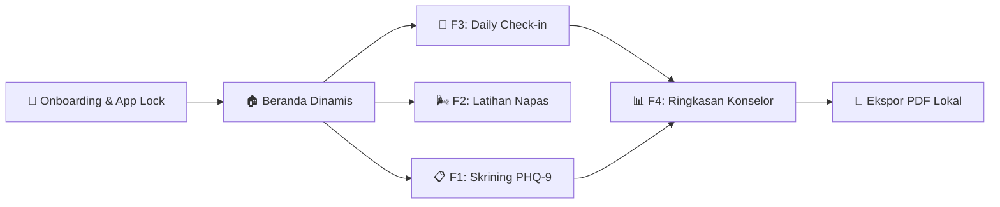

# Selaras Mobile

[-3DDC84?logo=android&logoColor=white)](https://developer.android.com)
[](https://kotlinlang.org)
[](https://developer.android.com/jetpack/compose)
[-00599C?logo=sqlite&logoColor=white)](https://www.zetetic.net/sqlcipher/)
[](docs/ARCHITECTURE.md)
[](https://square.github.io/retrofit/)

> **Selaras Mobile** adalah aplikasi pendamping kesehatan emosional mandiri (*self-care companion*) berbasis Android yang mengusung paradigma **Offline-First Ready**. Aplikasi ini memfasilitasi pencatatan suasana hati harian, latihan pernapasan ritmis terpandu, penapisan depresi baku menggunakan kuesioner **PHQ-9**, serta pembuatan ringkasan terstruktur (**Counselor Summary**) yang siap diekspor ke dalam format PDF untuk sesi konsultasi tatap muka bersama psikolog atau konselor berlisensi.

---

## 📑 Daftar Isi

- [Gambaran Umum](#-gambaran-umum)
- [Fitur Utama](#-fitur-utama)
- [Arsitektur Sistem & Pola Data](#-arsitektur-sistem--pola-data)
- [Tech Stack & Dependensi Kunci](#-tech-stack--dependensi-kunci)
- [Struktur Paket Proyek](#-struktur-paket-proyek)
- [Panduan Memulai (Getting Started)](#-panduan-memulai-getting-started)
- [Pengujian Unit (Unit Testing)](#-pengujian-unit-unit-testing)
- [Mode Demo & Seeder Data](#-mode-demo--seeder-data)

---

## 🌿 Gambaran Umum

Banyak orang mengalami tekanan psikologis namun kesulitan mengungkapkan apa yang dialami secara runtut ketika menemui tenaga profesional, atau merasa enggan menggunakan aplikasi kesehatan mental karena keharusan mendaftarkan akun di server pihak ketiga.

**Selaras Mobile** dibangun untuk menjawab permasalahan tersebut dengan mengedepankan:
1. **Operasional 100% Offline**: Pengguna tidak dipaksa mendaftar akun atau terhubung ke internet untuk dapat menggunakan seluruh fitur utama.
2. **Kedaulatan & Keamanan Data Tingkat Perbankan**: Basis data lokal SQLite terenkripsi penuh menggunakan **SQLCipher (AES-256)** dengan kunci utama dilindungi oleh **Android Keystore System**.
3. **Instrumen Klinis Baku & Bertanggung Jawab**: Menggunakan kuesioner baku **PHQ-9** dengan penegasan etis bahwa hasil penapisan adalah indikasi awal dan bukan diagnosis medis.
4. **Offline-First Ready**: Dilengkapi dengan lapisan jaringan (Retrofit 2 & OkHttp 3) dan mesin sinkronisasi dua arah (*Sync Engine*) yang siap menghubungkan data lokal ke server backend (Node.js + MySQL) secara opsional di masa mendatang ([ADR-014](docs/DECISIONS.md#adr-014-desain-skema-dan-arsitektur-offline-first-ready-uuid-soft-delete-sync-engine)).

---

## ✨ Fitur Utama


<table>
  <tr>
    <td width="50%" align="center" valign="top">
      
    </td>
    <td width="50%" align="center" valign="top">
      
    </td>
  </tr>
</table>


### 1. Onboarding, Informed Consent & Keamanan Akses
- **Splash & Edukasi Nilai**: 4 langkah pengenalan aplikasi dengan nuansa tenang.
- **Informed Consent**: Lembar persetujuan eksplisit yang menegaskan batasan medis non-diagnostik dan kebijakan penyimpanan lokal terenkripsi.
- **Kunci Aplikasi (App Lock PIN 6-Digit)**: Proteksi PIN lokal dengan *hashing* aman PBKDF2 (10.000 iterasi dengan salt 16-byte acak).
- **Alur Pemulihan (Recovery Code)**: Kode unik 16-karakter alfanumerik (`XXXX-XXXX-XXXX-XXXX`) untuk pemulihan akses jika pengguna lupa PIN tanpa merusak atau menghapus database.

### 2. Screening instrumen (PHQ-9)
- Menggunakan instrumen resmi 9 butir pertanyaan klinis tervalidasi dengan opsi bobot respons 0–3.
- Perhitungan skor otomatis (0–27) yang diklasifikasikan ke dalam 5 tingkatan keparahan: Minimal, Ringan, Sedang, Sedang-Berat, dan Berat.
- Penegakan kuota pengisian: maksimal 1 kali tes Rutin dan 1 kali tes Manual per minggu kalender via database composite unique index.
- **Protokol Penanganan Krisis Darurat**: Otomatis mendeteksi butir nomor 9 bernilai $\ge 1$ atau skor total $\ge 20$ untuk segera menampilkan rujukan bantuan darurat (**Hotline 119 Sejiwa**) sebelum skor ditampilkan.

### 3. Latihan Relaksasi Pernapasan Terpandu
- State machine ritme pernapasan adaptif (`BreathingSessionEngine`) dengan animasi visual dinamis.
- Menyediakan katalog pola napas baku (teknik *4-7-8 Relaxing Breath*, *Box Breathing*) serta pembuatan dan penyesuaian pola kustom (fase tarik, jeda, dan embus).
- Kontrol sesi interaktif (jeda/lanjutkan) tanpa kehilangan jejak siklus relaksasi.

### 4. Daily Check-in & Visualisasi Tren Emosi
- Wizard refleksi 4 langkah yang intuitif:
  1. *Mood*: Skala terstandarisasi **1–5** (Sangat Kurang Baik s.d. Sangat Baik).
  2. *Energi*: Skala terstandarisasi **1–10** (1 = Habis/Lelah, 10 = Penuh Semangat).
  3. *Tidur*: Durasi istirahat tidur malam (jam & menit).
  4. *Jurnal*: Catatan refleksi teks bebas harian.
- Pembatasan 1 entri check-in per hari untuk menjaga akurasi pemantauan longitudinal.
- Grafik garis tren 7 hari interaktif (`WeeklyPatternChart`) untuk mengidentifikasi pola kelelahan dan fluktuasi emosi.

### 5. Ringkasan Konselor & Ekspor PDF
- Validasi kelayakan data observasi minimal 4 hari check-in dalam periode observasi untuk menghasilkan sintesis rekapitulasi yang representatif.
- Penyimpanan imutabel berbasis snapshot JSON statis sehingga rekam jejak historis yang telah dibagikan tidak berubah bila entri masa lalu diubah.
- Rendering dan ekspor dokumen PDF lokal menggunakan Android Native Canvas yang siap dicetak atau dibagikan ke tenaga profesional (psikolog/konselor).

### 6. Pengaturan & Manajemen Data
- **Pengingat Harian**: Alarm notifikasi lokal harian (default pukul 21.00).
- **Hapus Semua Data**: Tombol darurat pembersihan seluruh database lokal secara permanen dengan konfirmasi 2 langkah.

---

## 🏗️ Arsitektur Sistem & Pola Data

Selaras Mobile menerapkan prinsip **Clean Architecture** yang memisahkan tanggung jawab ke dalam 4 lapisan independen:

```
┌─────────────────────────────────────────────────────────────┐
│                 Presentation Layer (Compose)                │
│             Screens · ViewModels (StateFlow) · UIState      │
└──────────────────────────────┬──────────────────────────────┘
                               │
┌──────────────────────────────▼──────────────────────────────┐
│                    Domain Layer (Pure Kotlin)               │
│             Models · Use Cases · Repository Contracts       │
└──────────────────────────────┬──────────────────────────────┘
                               │
┌──────────────────────────────▼──────────────────────────────┐
│                     Data Layer & Sync Engine                │
│    Repositories · Local Room DAOs · Remote DTOs · SyncMgr   │
└──────────────────────────────┬──────────────────────────────┘
                               │
┌──────────────────────────────▼──────────────────────────────┐
│                  Core & Security Infrastructure             │
│   SQLCipher (AES-256) · Keystore · Navigation · DI Container │
└─────────────────────────────────────────────────────────────┘
```

### Keamanan Basis Data:
- **Pemisahan Kunci (DEK) & PIN (ADR-002)**: Kunci enkripsi database (*Database Encryption Key* / DEK) berukuran 256-bit dibuat secara independen saat aplikasi pertama kali dipasang dan dilindungi oleh *Key Encryption Key* (KEK) berbasis perangkat keras di Android Keystore (`AES/GCM/NoPadding`). PIN pengguna hanya bertindak sebagai kunci gerbang antarmuka, sehingga penggantian PIN tidak merusak atau menuntut re-enkripsi basis data secara keseluruhan.

---

## 🛠️ Tech Stack & Dependensi Kunci

| Pustaka / Komponen | Versi | Peran & Tanggung Jawab |
|---|---|---|
| **Kotlin** | `2.2.10` | Bahasa pemrograman utama aplikasi |
| **Android Gradle Plugin** | `9.3.3` | Build tool dan sistem kompilasi aplikasi |
| **Kotlin Symbol Processing (KSP)**| `2.2.10-2.0.2` | Pemrosesan anotasi Room pada waktu kompilasi |
| **Jetpack Compose BOM** | `2026.02.01` | Deklaratif UI framework modern |
| **Compose Material 3** | BOM Managed | Komponen desain standar Material 3 |
| **Navigation Compose** | `2.8+` | Navigasi deklaratif dengan Type-Safe Routes |
| **AndroidX Room** | `2.8.5` (Schema v4) | Abstraksi ORM SQLite lokal |
| **SQLCipher for Android** | `4.20.0` | Mesin enkripsi transparan basis data (AES-256) |
| **Android Keystore System** | Native Android | Penyimpanan kunci hardware-backed KEK |
| **Coroutines & StateFlow** | Native Kotlin | Manajemen asinkron dan pemrograman reaktif stream data |
| **Retrofit 2 & OkHttp 3** | `2.11.0` / `4.12.0` | Komunikasi REST API dan logging HTTP interceptor |
| **Manual DI (`AppContainer`)** | Pola Desain | Injeksi dependensi terpusat tanpa pustaka pihak ketiga |
| **Robolectric & JUnit 4** | `4.14.1` / `4.13.2` | Unit test lokal dan simulasi konteks Android |

---

## 📁 Struktur Paket Proyek

```
app/src/main/java/com/example/selaras/
├── core/                                # Pondasi transversal aplikasi
│   ├── database/                        # Room Database, TypeConverters, dan DAO
│   │   ├── converter/                   # DateConverter & ScreeningConverter
│   │   ├── dao/                         # CheckInDao, ScreeningDao, AppSettingsDao, dll.
│   │   └── SelarasDatabase.kt           # Definisi Database terenkripsi (Schema v4)
│   ├── di/                              # Dependency Injection manual
│   │   └── AppContainer.kt              # Service locator & factory dependency
│   ├── navigation/                      # Navigasi Type-Safe
│   │   ├── AppNavigation.kt             # Definisi rute @Serializable & NavHost
│   │   └── BottomNavBar.kt              # Komponen bilah navigasi bawah
│   ├── security/                        # Kriptografi dan autentikasi
│   │   ├── KeyManager.kt                # KEK Keystore & DEK database
│   │   ├── PinManager.kt                # Hash & verifikasi PIN lokal (PBKDF2)
│   │   └── RecoveryManager.kt           # Validasi & generasi Recovery Code
│   └── ui/                              # Desain global Material 3
│       ├── components/                  # Tombol, header, keypad, dialog
│       └── theme/                       # Color, Type, dan Theme terpadu
│
├── data/                                # Implementasi persistensi dan sinkronisasi
│   ├── datasource/
│   │   ├── local/                       # CheckInLocalDataSource, BreathingLocalDataSource
│   │   └── remote/                      # Remote DataSource contracts & DTO (Offline-First Ready)
│   ├── local/entity/                    # Entitas Room (CheckInEntity, ScreeningEntity, dll.)
│   ├── repository/                      # Implementasi konkrit domain repository
│   └── sync/                            # SyncManager (CheckInSyncManager, BreathingSyncManager)
│
├── domain/                              # Aturan bisnis murni (Pure Kotlin)
│   ├── model/                           # Model domain (CheckIn, ScreeningResult, BreathingPattern)
│   ├── repository/                      # Antarmuka kontrak repositori
│   └── usecase/                         # UseCase terisolasi (breathing, checkin, screening, counselor)
│
├── features/                            # Lapisan presentasi per fitur pengguna
│   ├── breathing/                       # Layar latihan relaksasi pernapasan
│   ├── checkin/                         # Layar check-in harian (4-step wizard) & visualisasi grafik
│   ├── counselor/                       # Pratinjau & penyusunan ringkasan PDF konselor
│   ├── dashboard/                       # Beranda utama, kartu status harian, aksi cepat
│   ├── help/                            # Layar kontak darurat & bantuan krisis
│   ├── history/                         # Daftar riwayat aktivitas
│   ├── onboarding/                      # Layar splash, perkenalan, dan persetujuan
│   ├── screening/                       # Kuesioner PHQ-9, kalkulasi skor, layar krisis
│   ├── security/                        # Layar PIN, input PIN, dan pemulihan kode
│   └── settings/                        # Pengaturan pengingat dan reset data
│
├── MainActivity.kt                      # Single Activity NavHost & demo seeder entry
└── SelarasApplication.kt                # Inisialisasi AppContainer tingkat aplikasi
```

---

## 🚀 Panduan Memulai (Getting Started)

### Prasyarat:
- **Android Studio**: Ladybug (2024.2.1+) atau Meerkat / versi terbaru.
- **Java Development Kit (JDK)**: JDK 17 atau JDK 21.
- **Android SDK**: Min SDK 24, Target SDK 37, Compile SDK 37.

### Langkah Instalasi:
1. Buka folder `mobile-selaras` pada Android Studio.
2. Tunggu proses **Gradle Sync** selesai mengunduh seluruh dependensi.
3. Hubungkan perangkat Android fisik atau jalankan emulator (API level $\ge 24$).
4. Jalankan aplikasi melalui tombol **Run (Shift + F10)** atau terminal:
   ```bash
   # Di Windows PowerShell:
   .\gradlew assembleDebug
   .\gradlew installDebug
   ```

---

## 🧪 Pengujian Unit (Unit Testing)

Aplikasi Selaras Mobile dilengkapi pengujian unit (*Unit Tests*) yang komprehensif mencakup Domain Use Cases, Repository, Room Database, State ViewModel, Kriptografi, hingga Sync Engine.

```bash
# Menjalankan unit tests lokal
.\gradlew testDebugUnitTest
```

### Berkas Pengujian Kunci:
- **Kriptografi & Keamanan**: `SecurityAndEncryptionTest.kt`, `SecurityRepositoryTest.kt`, `SecurityUseCasesTest.kt`.
- **Database Terenkripsi**: `SelarasDatabaseTest.kt`, `TypeConverterTest.kt`.
- **Check-in & Analisis Tren**: `CheckInUseCasesTest.kt`, `CheckInRepositoryTest.kt`, `CheckInViewModelTest.kt`.
- **Latihan Pernapasan**: `BreathingSessionEngineTest.kt`, `BreathingRepositoryTest.kt`, `BreathingPatternTest.kt`.
- **Skrining PHQ-9**: `GetScreeningQuotaUseCaseTest.kt`, `ScreeningUseCasesTest.kt`, `ScreeningViewModelTest.kt`.
- **Ringkasan Konselor**: `CounselorSummaryTest.kt`.
- **Offline-First Sync Engine**: `CheckInSyncManagerTest.kt`, `BreathingSyncManagerTest.kt`.

---

## 💡 Mode Demo & Seeder Data

Untuk mempermudah demonstrasi dan evaluasi tanpa harus mengisi check-in manual selama berhari-hari:
1. Buka berkas [MainActivity.kt](file:///D:/Selaras/mobile-selaras/app/src/main/java/com/example/selaras/MainActivity.kt#L70-L77).
2. Fungsi `seedDemoCheckIns(container.checkInRepository)` akan secara otomatis menginjeksikan data check-in realistis untuk 5 hari terakhir ke dalam database lokal saat aplikasi dijalankan.
3. Fitur **Grafik Tren 7 Hari** pada tab Check-in dan **Ringkasan Konselor (F4)** akan langsung terbuka dan siap dievaluasi.
4. Pasang tanda komentar kembali (*comment*) untuk mengembalikan aplikasi ke alur pengisian normal.

---
## Tautan Repository Backend
[Backend Repo](https://github.com/ihyaulumuddin14/selaras-backend)
