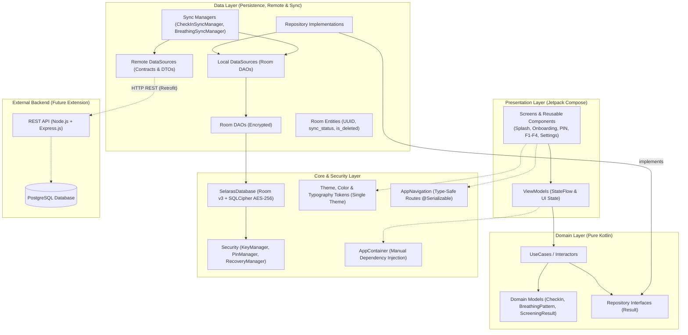
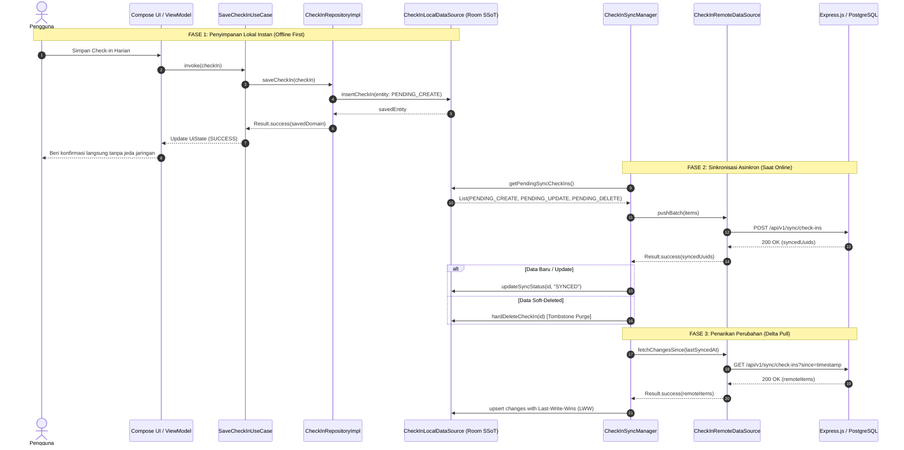
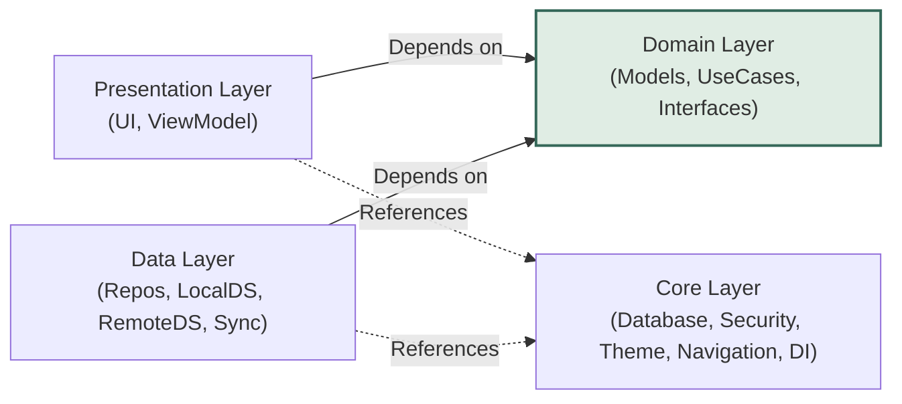

# Architecture Documentation — Selaras

| Metadata | Keterangan |
|---|---|
| **Aplikasi** | Selaras Android Client |
| **Arsitektur Utama** | Clean Architecture dengan Pola Layered (Presentation, Domain, Data, Core) |
| **Paradigma Data** | **Offline-First Ready (Single Source of Truth Room + Bidirectional Sync Engine)** |
| **Pola Presentasi** | MVVM / MVI dengan Jetpack Compose & StateFlow |
| **Dependency Injection** | **Manual Dependency Injection via `AppContainer` (ADR-011)** |
| **Navigasi** | **AndroidX Navigation Compose 2.8+ dengan Type-Safe Routes via Kotlin Serialization (ADR-012)** |
| **Tema Antarmuka** | Single Unified Theme — Warm Neutral Light Tone (ADR-013) |
| **Status Dokumen** | **Verified (Tersinkronisasi Penuh dengan ADR-001 s.d. ADR-014)** |
| **Versi Dokumen** | 2.0.0 |
| **Terakhir Diperbarui** | 2026-11-21 |

---

## 1. Technology Stack & Dependensi Kunci

Berdasarkan berkas konfigurasi aktual [build.gradle.kts](file:///D:/Andorid%20Studio/app/build.gradle.kts) dan [libs.versions.toml](file:///D:/Andorid%20Studio/gradle/libs.versions.toml) serta rekaman keputusan arsitektur (ADR):

| Komponen / Pustaka | Versi | Peran & Tanggung Jawab |
|---|---|---|
| **Kotlin** | `2.2.10` | Bahasa pemrograman utama aplikasi. |
| **Android Gradle Plugin (AGP)** | `8.9.0` | Build tool dan sistem kompilasi aplikasi Android. |
| **Kotlin Symbol Processing (KSP)** | `2.2.10-2.0.2` | Pemrosesan anotasi Room secara efisien pada waktu kompilasi. |
| **Jetpack Compose BOM** | `2026.02.01` | Manajer versi terpadu untuk pustaka antarmuka deklaratif Compose. |
| **Compose Material 3** | BOM managed | Komponen desain modern Material Design 3 (M3). |
| **Navigation Compose** | `2.8+` | Navigasi deklaratif antar layar dengan Type-Safe Routes (ADR-012). |
| **Kotlinx Serialization** | Native Kotlin | Serialisasi rute bertipe aman (`@Serializable`) untuk Navigation Compose. |
| **AndroidX Room** | `2.8.5` (Schema v4) | Abstraksi Object-Relational Mapping (ORM) untuk SQLite lokal terenkripsi. |
| **SQLCipher for Android** | `4.20.0` | Mesin enkripsi transparan tingkat basis data (AES-256). |
| **AndroidX SQLite** | `2.7.0` | Driver SQLite terpadu untuk AndroidX. |
| **KotlinX Coroutines & Flow** | Native Kotlin | Manajemen konkurensi asinkron dan pemrograman reaktif stream data. |
| **Android Keystore System** | Native Android | Penyimpanan kunci perangkat keras (*Hardware-backed Key Encryption Key*). |
| **Manual DI (`AppContainer`)** | Pola Desain | Penyediaan dependensi terpusat tanpa pustaka pihak ketiga (ADR-011). |
| **Offline-First Sync Engine** | Pola Desain | Kontrak sinkronisasi dua arah (`CheckInSyncManager`, `BreathingSyncManager`, ADR-014). |
| **Robolectric & JUnit 4** | `4.14.1` / `4.13.2` | Lingkungan pengujian unit lokal untuk simulasi context Android & Database. |

### Rencana Integrasi Backend Eksternal (Offline-First Extension)
Ketika server backend telah siap, stack berikut akan dihubungkan ke Data Layer tanpa merombak Presentation maupun Domain:
- **Android Networking**: Retrofit 2 + OkHttp 3 + Kotlinx Serialization Converter.
- **Background Sync Scheduler**: AndroidX WorkManager (menjalankan `SyncManager` berkala atau saat koneksi internet aktif).
- **Backend Stack**: Node.js + Express.js.
- **Server Database**: PostgreSQL.

---

## 2. Pola Arsitektur Sistem (*Architectural Pattern*)

Selaras mengadopsi prinsip **Clean Architecture** (Robert C. Martin) yang memisahkan kode ke dalam lapisan-lapisan konsentris independen. Dengan pendekatan **Offline-First Ready**, basis data lokal Room bertindak sebagai **Single Source of Truth (SSoT)**.

### Tiga Diagram Arsitektur Utama

#### Diagram 1: High-Level System Architecture (Offline-First Ready)


#### Diagram 2: Offline-First Data Flow & Sync Cycle


#### Diagram 3: Dependency Direction


---

## 3. Struktur Paket Aktual (*Package Structure*)

```
com.example.selaras/
│
├── core/                               # Komponen transversal / fondasi lintas fitur
│   ├── database/                       # Konfigurasi Room & SQLCipher
│   │   ├── converter/                  # TypeConverters (DateConverter, ScreeningConverter)
│   │   ├── dao/                        # Data Access Objects (AppSettings, CheckIn, CustomBreathing, Screening)
│   │   └── SelarasDatabase.kt          # RoomDatabase abstract class (Schema v4) & factory builder
│   ├── di/                             # Manual Dependency Injection (ADR-011)
│   │   └── AppContainer.kt             # Antarmuka AppContainer & DefaultAppContainer
│   ├── navigation/                     # Definisi rute navigasi aplikasi (ADR-012)
│   │   └── AppNavigation.kt            # Definisi rute Type-Safe (@Serializable) & NavHost
│   ├── security/                       # Manajemen enkripsi dan autentikasi lokal
│   │   ├── KeyManager.kt               # Pengelolaan DEK & KEK Android Keystore
│   │   ├── PinManager.kt               # Hash dan verifikasi PIN 6-digit (PBKDF2)
│   │   └── RecoveryManager.kt          # Pembangkitan dan validasi Recovery Code
│   └── ui/                             # Desain global dan tema Material 3
│       ├── components/                 # Komponen umum antarmuka (AppButton, Keypad, Dots)
│       └── theme/                      # Definisi Color.kt, Theme.kt, Type.kt (Single Theme)
│
├── data/                               # Implementasi akses data, sinkronisasi, dan entitas
│   ├── datasource/
│   │   ├── local/                      # Sumber data lokal Room DAO
│   │   │   ├── BreathingLocalDataSource.kt
│   │   │   └── CheckInLocalDataSource.kt
│   │   └── remote/                     # 📍 KONTRAK REMOTE & DTO (ADR-014)
│   │       ├── dto/                    # Network DTOs & Request/Response batch
│   │       │   ├── BreathingPatternNetworkDto.kt
│   │       │   └── CheckInNetworkDto.kt
│   │       ├── BreathingRemoteDataSource.kt
│   │       ├── CheckInRemoteDataSource.kt
│   │       ├── FakeBreathingRemoteDataSource.kt
│   │       └── FakeCheckInRemoteDataSource.kt
│   ├── local/entity/                   # Entitas Room Database (*Entity.kt)
│   ├── repository/                     # Implementasi konkret dari domain repository
│   │   ├── BreathingRepositoryImpl.kt  # Implementasi repositori pernapasan
│   │   ├── CheckInRepositoryImpl.kt    # Implementasi repositori check-in
│   │   └── ScreeningRepositoryImpl.kt  # Implementasi repositori skrining PHQ-9
│   └── sync/                           # 📍 MESIN SINKRONISASI OFFLINE-FIRST (ADR-014)
│       ├── BreathingSyncManager.kt     # Orkestrator sinkronisasi pola napas
│       └── CheckInSyncManager.kt       # Orkestrator sinkronisasi check-in
│
├── domain/                             # Aturan bisnis murni (independen platform)
│   ├── model/                          # Objek domain murni (CheckIn, BreathingPattern, WeeklyCheckInAnalysis)
│   ├── repository/                     # Kontrak antarmuka repositori (*Repository.kt)
│   └── usecase/                        # Kasus penggunaan granular per fitur
│       ├── breathing/                  # UseCase latihan relaksasi pernapasan
│       ├── checkin/                    # UseCase pencatatan dan analisis check-in
│       ├── counselor/                  # UseCase kompilasi ringkasan konselor & PDF
│       └── screening/                  # UseCase pengiriman skrining PHQ-9
│
├── features/                           # Antarmuka per fitur pengguna (UI & ViewModel)
│   ├── breathing/                      # BreathingScreen.kt & BreathingViewModel.kt
│   ├── checkin/                        # CheckInScreen.kt & CheckInViewModel.kt (4-step Wizard, 7-day Analysis)
│   ├── counselor/                      # CounselorSummaryScreen.kt & ViewModel
│   ├── dashboard/                      # DashboardScreen.kt & DashboardViewModel.kt
│   ├── help/                           # HelpScreen.kt (Kontak bantuan krisis)
│   ├── history/                        # HistoryScreen.kt (Daftar riwayat)
│   ├── onboarding/                     # OnboardingScreen.kt & ViewModel (Splash, Consent, PIN)
│   ├── screening/                      # ScreeningScreen.kt & ScreeningViewModel.kt
│   └── settings/                       # SettingsScreen.kt (Pengaturan PIN, Pengingat, Reset data)
│
├── SelarasApplication.kt               # Application subclass penginisialisasi AppContainer (ADR-011)
└── MainActivity.kt                     # Entry point aktivitas Android tunggal (Single Activity NavHost)
```

---

## 4. Rincian Layer dan Tanggung Jawab

### 4.1 Presentation Layer (`features/*` & `core/ui/*`)
- **Tanggung Jawab**: Merender antarmuka pengguna secara deklaratif menggunakan Jetpack Compose, menangkap gestur/interaksi pengguna, dan merefleksikan perubahan kondisi (*UiState*).
- **Prinsip**: UI hanya mengamati `StateFlow` dari ViewModel. UI tidak pernah mengetahui apakah data berasal dari Room lokal atau server backend.

### 4.2 Domain Layer (`domain/*`)
- **Tanggung Jawab**: Memuat entitas bisnis, logika analitik, dan antarmuka repositori.
- **Prinsip**: Bersih dari dependensi Room, SQLite, Retrofit, maupun Android SDK. Seluruh operasi eksternal mengembalikan tipe Kotlin baku `Result<T>`.

### 4.3 Data Layer (`data/*`)
- **Tanggung Jawab**: Mengelola persistensi data, abstraksi sumber data lokal (`LocalDataSource`), kontrak sumber data eksternal (`RemoteDataSource`), pemetaan DTO/Entity/Domain, serta orkestrasi sinkronisasi data (`SyncManager`).
- **Prinsip**: Room adalah Single Source of Truth lokal. Data dari jaringan selalu disimpan ke database Room terlebih dahulu sebelum dikonsumsi oleh lapisan atas.

### 4.4 Core Layer (`core/*`)
- **Tanggung Jawab**: Fondasi kriptografi (`KeyManager`, `PinManager`, `RecoveryManager`), inisialisasi basis data terenkripsi (`SelarasDatabase`), penyediaan dependensi (`AppContainer`), dan penataan rute navigasi terpusat.

---

## 5. Strategi Sinkronisasi Offline-First (*Offline-First Architecture*) (ADR-014)

Sistem sinkronisasi Selaras dirancang untuk memenuhi standar aplikasi offline-first modern yang tangguh terhadap fluktuasi koneksi:

### 5.1 Enam Pilar Offline-First Ready
1. **Single Source of Truth (SSoT)**: Room Database lokal adalah satu-satunya sumber data yang dibaca oleh UI melalui Coroutine Flow.
2. **Universal Unique Identifier (UUID v4)**: Setiap entitas yang dapat disinkronkan memiliki kolom `uuid: String` (berindeks unik) di samping autoincrement `id: Long` lokal. Hal ini menjamin tidak terjadi tabrakan identitas saat data digabungkan dengan PostgreSQL.
3. **Siklus Status Sinkronisasi (`sync_status`)**:
   - `SYNCED`: Data lokal dan server identik.
   - `PENDING_CREATE`: Data baru dibuat secara offline, menunggu dikirim ke server.
   - `PENDING_UPDATE`: Data diedit secara offline, menunggu pembaruan di server.
   - `PENDING_DELETE`: Data dihapus secara offline, menunggu penghapusan di server.
4. **Pola Soft Delete & Pembersihan Tombstone (*Tombstone Purge*)**:
   - Saat pengguna menghapus data secara lokal, data tidak langsung dihapus dari SQLite, melainkan ditandai `is_deleted = 1` dan `sync_status = 'PENDING_DELETE'`.
   - Kueri baca aktif selalu memfilter `WHERE is_deleted = 0`.
   - Setelah server mengonfirmasi penghapusan remote, data lokal dibersihkan permanen (*hard delete*) agar database lokal tetap ramping.
5. **Resolusi Konflik Last-Write-Wins (LWW)**:
   - Jika terdapat perbedaan antara data lokal dan data server, sistem membandingkan timestamp `updated_at`. Data dengan waktu pembaruan termutakhir yang akan dipertahankan.
6. **Batch Sync Efficiency**:
   - Permintaan sinkronisasi dikemas dalam format *batch request* (`SyncCheckInBatchRequestDto`, `SyncBreathingBatchRequestDto`) untuk menghemat konsumsi daya baterai dan kuota data.

---

## 6. Strategi Dependency Injection (*Manual DI dengan AppContainer*) (ADR-011)

Sesuai kesepakatan **ADR-011**, aplikasi Selaras menggunakan pola **Manual Dependency Injection** menggunakan `AppContainer` tanpa pustaka pihak ketiga.

### 6.1 Struktur `AppContainer` Aktual

```kotlin
// core/di/AppContainer.kt
interface AppContainer {
    val database: SelarasDatabase
    val keyManager: KeyManager
    val pinManager: PinManager
    val recoveryManager: RecoveryManager
    val breathingRepository: BreathingRepository
    val checkInRepository: CheckInRepository
    val screeningRepository: ScreeningRepository
    val checkInSyncManager: CheckInSyncManager
    val breathingSyncManager: BreathingSyncManager
}
```

Implementasi `DefaultAppContainer` menginstansiasi repositori lokal dan menyematkan `FakeRemoteDataSource` sebagai penyedia remote sementara. Ketika backend Express.js telah siap, penggantian hanya dilakukan pada `DefaultAppContainer` dengan mengarahkan `RemoteDataSource` ke implementasi Retrofit.

---

## 7. Arsitektur Navigasi (*Type-Safe Navigation Compose*) (ADR-012)

Sesuai kesepakatan **ADR-012**, aplikasi menggunakan **AndroidX Navigation Compose 2.8+** berbasis rute bertipe aman (*Type-Safe Routes*) menggunakan Kotlin Serialization (`@Serializable`). Seluruh destinasi terpusat pada `core/navigation/AppNavigation.kt`.

---

## 8. Keamanan & Database Terenkripsi

1. **SQLCipher**: Mengamankan berkas `selaras.db` pada storage privat Android menggunakan enkripsi transparan AES-256.
2. **Hardware KeyStore**: Kunci DEK dilindungi oleh KEK Keystore (`AndroidKeyStore`).
3. **Pemisahan Kunci (ADR-002)**: PIN pengguna hanya berfungsi sebagai kunci UI App Lock yang di-hash menggunakan PBKDF2WithHmacSHA256 (10.000 iterasi). Mengganti PIN tidak memerlukan re-key basis data.
4. **Recovery Code (ADR-003)**: Menyediakan kode 16-karakter acak alfanumerik untuk pemulihan akses darurat tanpa server.

---

## 9. Strategi Pengujian (*Testing Strategy*)

- **Unit Testing Pure Domain**: Menguji Use Case murni (`SaveCheckInUseCase`, `GetWeeklyCheckInAnalysisUseCase`, dll) tanpa dependensi Android.
- **Database & DAO Testing**: Menguji operasi Room DAO, constraint SQLite, soft-delete filtering, dan cascade delete via Robolectric.
- **Offline-First Sync Engine Testing**: Menguji siklus push pending, tombstone purge, delta pull, dan penanganan kegagalan jaringan pada `CheckInSyncManagerTest` dan `BreathingSyncManagerTest`.
- **ViewModel Lifecycle Testing**: Memverifikasi emisi StateFlow pada ViewModel untuk setiap aksi pengguna (`CheckInViewModelTest`).
