# Entity Relationship Diagram (ERD) & Database Specification — Selaras

| Metadata | Keterangan |
|---|---|
| **Database Engine** | SQLite terenkripsi penuh via **SQLCipher** (net.zetetic:sqlcipher-android v4.20.0) |
| **ORM Framework** | **Android Room** (androidx.room v2.8.5) dengan KSP |
| **Nama Berkas Database** | `selaras.db` |
| **Room Schema Version** | **Version 4** (Offline-First Ready dengan UUID & Soft-Delete, entitas counselor_summaries) |
| **Status Dokumen** | **Verified (Tersinkronisasi Penuh dengan Source Code, Schema v4 & ADR-014)** |
| **Berkas Skema Rujukan** | [4.json](file:///D:/Andorid%20Studio/app/schemas/com.example.selaras.core.database.SelarasDatabase/4.json) |
| **Terakhir Diperbarui** | 2026-11-21 |

---

## 1. Gambaran Umum Database

Database aplikasi **Selaras** dirancang dengan paradigma **Offline-First Ready** berstandar keamanan tinggi:
1. **Enkripsi Transparan**: Seluruh tabel, indeks, dan *page cache* dienkripsi dengan algoritma AES-256-CBC melalui SQLCipher.
2. **Kunci Enkripsi Terisolasi**: Kunci enkripsi 256-bit (*Database Encryption Key* / DEK) dibangkitkan secara acak dan dilindungi oleh Android Keystore hardware (*Key Encryption Key* / KEK).
3. **Penyimpanan Tipe Kompleks**: Menggunakan `TypeConverters` untuk mengonversi objek Java Time modern (`LocalDate`, `LocalTime`, `Instant`) dan Enum domain (`ScreeningType`, `ScreeningCategory`) ke format string ISO-8601 yang aman dan terindeks.
4. **Integritas Referensial**: Mengaktifkan *foreign key constraints* dengan perilaku penghapusan berantai (*Cascade Delete*) untuk menjaga konsistensi relasi induk-anak.
5. **Kesiapan Sinkronisasi Terdistribusi (ADR-014)**:
   - Kolom `uuid: String` (UUID v4 berindeks unik) pada setiap entitas yang disinkronkan, menjamin tidak ada tabrakan identitas (*ID collisions*) dengan PostgreSQL server.
   - Kolom `sync_status: String` (`SYNCED`, `PENDING_CREATE`, `PENDING_UPDATE`, `PENDING_DELETE`).
   - Pola **Soft Delete** (`is_deleted: Boolean`), mencegah penghapusan prematur sebelum server mereplikasi penghapusan tersebut.
6. **Sinkronisasi Skala Data (ADR-010)**:
   - Nilai suasana hati (**Mood**) divalidasi pada rentang **`1..5`**.
   - Nilai tingkat energi (**Energy**) divalidasi pada rentang **`1..10`** (tervalidasi pada `CheckIn.kt`, `CheckInEntity.kt`, dan desain revisi Figma `168:2320`).

---

## 2. Diagram ERD (Mermaid)

```mermaid
erDiagram
    app_settings {
        INTEGER id PK "Singleton ID = 1"
        TEXT first_activated_at "ISO-8601 Instant"
        INTEGER onboarding_completed "Boolean (0 atau 1)"
        TEXT consent_accepted_at "ISO-8601 Instant, Nullable"
        INTEGER checkin_reminder_enabled "Boolean (0 atau 1)"
        TEXT checkin_reminder_time "Format HH:mm:ss, Nullable"
        TEXT created_at "ISO-8601 Instant"
        TEXT updated_at "ISO-8601 Instant"
    }

    check_ins {
        INTEGER id PK "Auto Increment (Local Room PK)"
        TEXT uuid UK "UUID v4 (Global Unique Index)"
        TEXT user_id "Nullable, Akun Pengguna Backend"
        TEXT check_in_date UK "Format YYYY-MM-DD, Unik per hari"
        INTEGER mood "Skala 1-5"
        INTEGER energy "Skala 1-10 (Sesuai ADR-010)"
        INTEGER sleep_duration_minutes "Durasi tidur dalam menit"
        TEXT note "Catatan refleksi harian, Nullable"
        TEXT sync_status "SYNCED / PENDING_CREATE / PENDING_UPDATE / PENDING_DELETE"
        INTEGER is_deleted "Boolean (0 atau 1) untuk soft-delete"
        TEXT created_at "ISO-8601 Instant"
        TEXT updated_at "ISO-8601 Instant"
    }

    screening_results {
        INTEGER id PK "Auto Increment"
        TEXT screening_type "Enum: manual / routine"
        TEXT period_start_date "Format YYYY-MM-DD"
        TEXT period_end_date "Format YYYY-MM-DD"
        TEXT instrument_version "Contoh: PHQ-9 v1.0"
        TEXT completed_at "ISO-8601 Instant"
        INTEGER total_score "Skor total: 0-27"
        TEXT category "Enum: minimal/ringan/sedang/sedang_berat/berat"
        INTEGER help_indicator "Boolean (0 atau 1), indikator krisis"
        TEXT created_at "ISO-8601 Instant"
    }

    screening_answers {
        INTEGER id PK "Auto Increment"
        INTEGER screening_result_id FK "Relasi ke screening_results.id (CASCADE)"
        INTEGER question_number "Nomor pertanyaan 1-9"
        INTEGER answer_value "Nilai pilihan 0-3"
    }

    custom_breathing_patterns {
        INTEGER id PK "Auto Increment (Local Room PK)"
        TEXT uuid UK "UUID v4 (Global Unique Index)"
        TEXT user_id "Nullable, Akun Pengguna Backend"
        TEXT name "Nama pola pernapasan kustom"
        INTEGER inhale_duration_seconds "Durasi tarik napas (detik)"
        INTEGER exhale_duration_seconds "Durasi embus napas (detik)"
        TEXT sync_status "SYNCED / PENDING_CREATE / PENDING_UPDATE / PENDING_DELETE"
        INTEGER is_deleted "Boolean (0 atau 1) untuk soft-delete"
        TEXT created_at "ISO-8601 Instant"
        TEXT updated_at "ISO-8601 Instant"
    }

    counselor_summaries {
        INTEGER id PK "Auto Increment"
        INTEGER screening_result_id FK "Relasi ke screening_results.id (CASCADE)"
        TEXT period_start_date "Format YYYY-MM-DD"
        TEXT period_end_date "Format YYYY-MM-DD"
        INTEGER include_checkin_analysis "Boolean (0 atau 1)"
        INTEGER checkin_days_count "Jumlah hari check-in terdata (min 4)"
        TEXT rule_version "Versi aturan agregasi, Nullable"
        TEXT snapshot_json "Snapshot data lengkap terstruktur JSON"
        TEXT created_at "ISO-8601 Instant"
    }

    screening_results ||--|{ screening_answers : "memiliki 9 butir jawaban"
    screening_results ||--o{ counselor_summaries : "menjadi dasar ringkasan"
```



---

## 3. Spesifikasi Rinci Setiap Tabel

### 3.1 Tabel `app_settings`
Tabel preferensi global aplikasi dan status pengguna. Dikelola dengan pola baris tunggal (*singleton pattern*) dengan `id = 1`.

| Nama Kolom | Tipe SQLite | Tipe Kotlin | Nullable | Default | Keterangan & Constraint |
|---|---|---|---|---|---|
| `id` | `INTEGER` | `Long` | **No** | `1` | **Primary Key**. Dibatasi pada konstanta `SINGLETON_ID = 1L`. |
| `first_activated_at` | `TEXT` | `Instant` | **No** | - | Waktu aplikasi pertama kali diinisialisasi (ISO-8601 UTC). |
| `onboarding_completed`| `INTEGER` | `Boolean` | **No** | `0` | Flag penanda apakah proses orientasi telah selesai (`0` = false, `1` = true). |
| `consent_accepted_at` | `TEXT` | `Instant?` | Yes | `NULL` | Waktu persetujuan *informed consent* diberikan. |
| `checkin_reminder_enabled` | `INTEGER` | `Boolean` | **No** | `0` | Status aktivasi alarm pengingat harian. |
| `checkin_reminder_time` | `TEXT` | `LocalTime?` | Yes | `NULL` | Jam pengingat harian format `HH:mm:ss`. |
| `created_at` | `TEXT` | `Instant` | **No** | - | Waktu pembuatan baris pengaturan. |
| `updated_at` | `TEXT` | `Instant` | **No** | - | Waktu pembaruan terakhir baris pengaturan. |

---

### 3.2 Tabel `check_ins`
Tabel transaksi harian pencatatan suasana hati, energi, durasi tidur, dan refleksi pengguna dengan dukungan **Offline-First Ready**.

| Nama Kolom | Tipe SQLite | Tipe Kotlin | Nullable | Default | Keterangan & Constraint |
|---|---|---|---|---|---|
| `id` | `INTEGER` | `Long` | **No** | Autoincrement | **Primary Key lokal**. |
| `uuid` | `TEXT` | `String` | **No** | UUID v4 | **Global Identifier**. **UNIQUE INDEX** untuk sinkronisasi backend. |
| `user_id` | `TEXT` | `String?` | Yes | `NULL` | Identifier akun backend pengguna (untuk multi-tenant/auth). |
| `check_in_date` | `TEXT` | `LocalDate` | **No** | - | Tanggal entri kalender (`YYYY-MM-DD`). **UNIQUE INDEX**. |
| `mood` | `INTEGER` | `Int` | **No** | - | Penilaian suasana hati. Validasi domain: `1..5`. |
| `energy` | `INTEGER` | `Int` | **No** | - | Penilaian energi harian. Validasi domain: **`1..10`** (ADR-010). |
| `sleep_duration_minutes` | `INTEGER` | `Int` | **No** | - | Total durasi tidur dalam menit. |
| `note` | `TEXT` | `String?` | Yes | `NULL` | Catatan refleksi kualitatif opsional (maks 500 karakter). |
| `sync_status` | `TEXT` | `String` | **No** | `'SYNCED'` | Status sinkronisasi: `SYNCED`, `PENDING_CREATE`, `PENDING_UPDATE`, `PENDING_DELETE`. |
| `is_deleted` | `INTEGER` | `Boolean` | **No** | `0` | Flag soft delete: `0` = aktif, `1` = soft-deleted. |
| `created_at` | `TEXT` | `Instant` | **No** | - | Waktu pembuatan pertama kali (ISO-8601 UTC). |
| `updated_at` | `TEXT` | `Instant` | **No** | - | Waktu pembaruan terakhir (digunakan untuk LWW conflict resolution). |

**Indeks:**
- `index_check_ins_uuid` (UNIQUE): Menjamin keunikan pengenal entitas terdistribusi.
- `index_check_ins_check_in_date` (UNIQUE): Menjamin satu entri per hari kalender.

---

### 3.3 Tabel `custom_breathing_patterns`
Tabel katalog pola latihan pernapasan kustom yang dirancang oleh pengguna secara mandiri.

| Nama Kolom | Tipe SQLite | Tipe Kotlin | Nullable | Default | Keterangan & Constraint |
|---|---|---|---|---|---|
| `id` | `INTEGER` | `Long` | **No** | Autoincrement | **Primary Key lokal**. |
| `uuid` | `TEXT` | `String` | **No** | UUID v4 | **Global Identifier**. **UNIQUE INDEX** untuk sinkronisasi backend. |
| `user_id` | `TEXT` | `String?` | Yes | `NULL` | Identifier akun backend pengguna. |
| `name` | `TEXT` | `String` | **No** | - | Nama pola pernapasan kustom. |
| `inhale_duration_seconds` | `INTEGER` | `Int` | **No** | - | Durasi fase tarik napas dalam detik. |
| `exhale_duration_seconds` | `INTEGER` | `Int` | **No** | - | Durasi fase embus napas dalam detik. |
| `sync_status` | `TEXT` | `String` | **No** | `'SYNCED'` | Status sinkronisasi: `SYNCED`, `PENDING_CREATE`, `PENDING_UPDATE`, `PENDING_DELETE`. |
| `is_deleted` | `INTEGER` | `Boolean` | **No** | `0` | Flag soft delete: `0` = aktif, `1` = soft-deleted. |
| `created_at` | `TEXT` | `Instant` | **No** | - | Waktu pembuatan (ISO-8601 UTC). |
| `updated_at` | `TEXT` | `Instant` | **No** | - | Waktu pembaruan (digunakan untuk LWW conflict resolution). |

**Indeks:**
- `index_custom_breathing_patterns_uuid` (UNIQUE): Menjamin keunikan global pola pernapasan.

---

### 3.4 Tabel `screening_results`
Tabel hasil penilaian penapisan depresi PHQ-9. Menyimpan hasil kalkulasi skor, kategori risiko, dan indikator krisis.

| Nama Kolom | Tipe SQLite | Tipe Kotlin | Nullable | Default | Keterangan & Constraint |
|---|---|---|---|---|---|
| `id` | `INTEGER` | `Long` | **No** | Autoincrement | **Primary Key**. Pengenal unik hasil penapisan. |
| `screening_type` | `TEXT` | `ScreeningType` | **No** | - | Tipe penapisan: `'manual'` atau `'routine'`. |
| `period_start_date` | `TEXT` | `LocalDate` | **No** | - | Tanggal awal rentang 14 hari observasi PHQ-9. |
| `period_end_date` | `TEXT` | `LocalDate` | **No** | - | Tanggal akhir rentang 14 hari observasi PHQ-9. |
| `instrument_version` | `TEXT` | `String` | **No** | - | Versi instrumen (contoh: `'PHQ-9 v1.0'`). |
| `completed_at` | `TEXT` | `Instant` | **No** | - | Waktu penyelesaian penapisan secara lengkap. |
| `total_score` | `INTEGER` | `Int` | **No** | - | Skor kumulatif PHQ-9 (`0..27`). |
| `category` | `TEXT` | `ScreeningCategory`| **No** | - | Kategori: `'minimal'`, `'ringan'`, `'sedang'`, `'sedang_berat'`, `'berat'`. |
| `help_indicator` | `INTEGER` | `Boolean` | **No** | - | Indikator krisis: bernilai `1` jika butir 9 > 0 atau skor $\ge 20$. |
| `created_at` | `TEXT` | `Instant` | **No** | - | Waktu pencatatan. |

---

### 3.5 Tabel `screening_answers`
Tabel rincian butir jawaban dari penapisan PHQ-9. Terikat dengan relasi foreign key berantai (*Cascade Delete*) ke `screening_results`.

| Nama Kolom | Tipe SQLite | Tipe Kotlin | Nullable | Default | Keterangan & Constraint |
|---|---|---|---|---|---|
| `id` | `INTEGER` | `Long` | **No** | Autoincrement | **Primary Key**. |
| `screening_result_id` | `INTEGER` | `Long` | **No** | - | **Foreign Key** ke `screening_results(id)` ON DELETE CASCADE. |
| `question_number` | `INTEGER` | `Int` | **No** | - | Nomor urut butir kuesioner PHQ-9 (`1..9`). |
| `answer_value` | `INTEGER` | `Int` | **No** | - | Bobot jawaban pengguna (`0..3`). |

---

### 3.6 Tabel `counselor_summaries`
Tabel dokumen agregasi ringkasan klinis yang dirancang untuk diekspor ke format PDF bagi konselor/psikolog.

| Nama Kolom | Tipe SQLite | Tipe Kotlin | Nullable | Default | Keterangan & Constraint |
|---|---|---|---|---|---|
| `id` | `INTEGER` | `Long` | **No** | Autoincrement | **Primary Key**. |
| `screening_result_id` | `INTEGER` | `Long` | **No** | - | **Foreign Key** ke `screening_results(id)` ON DELETE CASCADE. |
| `period_start_date` | `TEXT` | `LocalDate` | **No** | - | Tanggal awal periode rekap data. |
| `period_end_date` | `TEXT` | `LocalDate` | **No** | - | Tanggal akhir periode rekap data. |
| `include_checkin_analysis` | `INTEGER` | `Boolean` | **No** | - | Flag apakah menyertakan analisis pola check-in. |
| `checkin_days_count` | `INTEGER` | `Int` | **No** | - | Jumlah hari check-in terdata (validasi K02: minimal 4 hari). |
| `rule_version` | `TEXT` | `String?` | Yes | `NULL` | Versi aturan agregasi. |
| `snapshot_json` | `TEXT` | `String` | **No** | - | Snapshot data lengkap dalam format teks JSON statis (ADR-008). |
| `created_at` | `TEXT` | `Instant` | **No** | - | Waktu pembuatan dokumen ringkasan. |

---

## 4. Mekanisme Sinkronisasi Offline-First pada Kueri DAO

Untuk mendukung strategi sinkronisasi dua arah tanpa menghambat performa lokal:
1. **Kueri Tampilan Aktif**: Seluruh kueri `SELECT` yang dikonsumsi oleh antarmuka pengguna wajib memfilter rekaman soft-delete:
   ```sql
   SELECT * FROM check_ins WHERE is_deleted = 0 ORDER BY check_in_date DESC
   ```
2. **Kueri Pending Sync**: Kueri khusus yang dieksekusi oleh `SyncManager` untuk menemukan mutasi offline yang belum tersinkronkan ke server:
   ```sql
   SELECT * FROM check_ins WHERE sync_status != 'SYNCED'
   ```
3. **Pembersihan Tombstone**: Setelah server mengonfirmasi penghapusan remote, kueri hard-delete dipanggil:
   ```sql
   DELETE FROM check_ins WHERE id = :id
   ```
