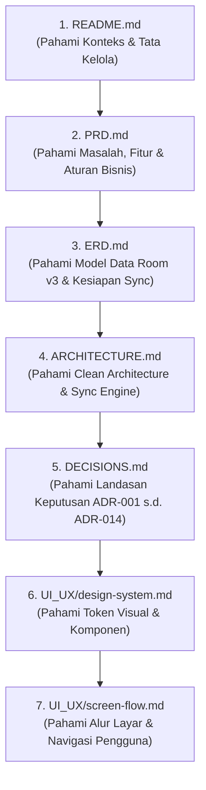

# Dokumentasi Teknis dan Produk Selaras

Selamat datang di repositori dokumentasi resmi untuk aplikasi Android **Selaras** (sebelumnya diidentifikasi dalam prototipe handoff sebagai *Serasi*). Dokumen ini berfungsi sebagai panduan induk, indeks navigasi, serta pedoman tata kelola dan pemeliharaan dokumentasi teknis dan produk.

---

## 1. Gambaran Singkat Proyek

**Selaras** adalah aplikasi *self-care* dan pendamping kesehatan emosional berbasis Android yang dirancang dengan pendekatan etis, privat, dan **Offline-First Ready**:
- **Offline-First Ready & Data Privasi**: Seluruh data tersimpan secara lokal pada perangkat pengguna menggunakan database SQLite terenkripsi (**SQLCipher**) dan kunci perangkat keras (**Android Keystore**). Aplikasi tidak mewajibkan registrasi akun cloud untuk seluruh fungsi intinya, namun skema data dan lapisan arsitektur data telah dilengkapi kontrak jaringan dan mesin sinkronisasi dua arah (**Sync Engine**) untuk integrasi backend masa depan (ADR-014).
- **Standar Klinis & Etis**: Menyediakan instrumen penapisan depresi baku (**PHQ-9**) yang diproses secara lokal dengan penegasan bahwa hasil penapisan adalah indikasi awal dan bukan diagnosis klinis.
- **Pencatatan Emosional & Energi Terstandar**: Skala penilaian suasana hati (*Mood*) distandarisasi pada rentang **1–5**, dan skala penilaian tingkat energi distandarisasi pada rentang **1–10** sesuai spesifikasi PRD, model domain ERD, dan antarmuka revisi Figma (ADR-010).
- **Dukungan Konseling Nyata**: Memfasilitasi rekapitulasi data *check-in* harian dan penapisan berkala ke dalam berkas terstruktur (**Ringkasan Konselor**) yang siap diekspor ke format PDF untuk sesi konsultasi profesional.
- **Desain & Alur Terpadu**: Seluruh layar antarmuka pengguna—termasuk *Splash Screen*, *Onboarding*, *Informed Consent*, *App Lock (PIN)*, *Recovery Code*, *Settings*, serta Fitur 2 (Pernapasan) dan Fitur 3 (Daily Check-in)—telah tersedia, teruji 100%, dan terpetakan secara lengkap dari desain Figma.

---

## 2. Struktur dan Tujuan Dokumen

Seluruh dokumentasi teknis dan spesifikasi produk tersusun secara modular di dalam direktori `docs/` sebagai berikut:

```
docs/
├── README.md               # Indeks utama, pedoman tata kelola, dan sumber kebenaran (file ini)
├── PRD.md                  # Product Requirements Document (kebutuhan produk, batasan & aturan bisnis)
├── ERD.md                  # Entity Relationship Diagram & spesifikasi database aktual (Schema v3)
├── ARCHITECTURE.md         # Arsitektur sistem Clean Architecture, Offline-First Ready & Sync Engine
├── DECISIONS.md            # Architecture & Product Decision Records (ADR-001 s.d. ADR-014)
└── UI_UX/
    ├── design-system.md    # Design tokens, tipografi, warna, spacing, dan komponen UI Figma
    └── screen-flow.md      # Alur navigasi antar-layar dan inventaris frame Figma
```

### Rincian Tujuan File

| Nama File | Dokumen | Tujuan & Cakupan |
|---|---|---|
| [README.md](file:///D:/Andorid%20Studio/docs/README.md) | **Index & Governance** | Memberikan pengantar arsitektur dokumentasi, pedoman pembacaan, dan panduan kontribusi pembaruan. |
| [PRD.md](file:///D:/Andorid%20Studio/docs/PRD.md) | **Product Requirements Document** | Menjelaskan latar belakang, visi produk, paradigma Offline-First Ready, skala metrik (Mood 1–5, Energi 1–10), dan aturan bisnis pengikat (K01–K07). |
| [ERD.md](file:///D:/Andorid%20Studio/docs/ERD.md) | **Entity Relationship Diagram** | Mendokumentasikan skema database Room v3 aktual (`3.json`), kolom UUID, kolom `sync_status`, flag `is_deleted` (soft-delete), relasi tabel, dan indeks unik. |
| [ARCHITECTURE.md](file:///D:/Andorid%20Studio/docs/ARCHITECTURE.md) | **System Architecture** | Menguraikan pola *Clean Architecture*, Room sebagai Single Source of Truth, Manual DI (`AppContainer`), Type-Safe Navigation Compose, dan mesin sinkronisasi dua arah. |
| [DECISIONS.md](file:///D:/Andorid%20Studio/docs/DECISIONS.md) | **Decision Records (ADR)** | Mencatat 14 rekaman keputusan arsitektur (ADR-001 s.d. ADR-014), termasuk kesiapan offline-first (ADR-014), amandemen offline-first (ADR-009), Manual DI (ADR-011), dan tema tunggal (ADR-013). |
| [UI_UX/design-system.md](file:///D:/Andorid%20Studio/docs/UI_UX/design-system.md) | **Design System Specification** | Memuat daftar *design tokens* (warna, tipografi, radius, spacing) yang selaras dengan ERD, *reusable components*, dan pemetaan ke Jetpack Compose M3 (tema tunggal). |
| [UI_UX/screen-flow.md](file:///D:/Andorid%20Studio/docs/UI_UX/screen-flow.md) | **Screen Inventory & User Flow** | Mendokumentasikan seluruh frame layar Android dari Figma (termasuk Splash, Onboarding, Consent, PIN, Recovery, Settings, dan Revisi F3 & F4) beserta diagram alirnya. |

---

## 3. Urutan Membaca yang Direkomendasikan



---

## 4. Sumber Kebenaran (*Single Source of Truth*)

| Aspek Proyek | Sumber Kebenaran Utama | Catatan Validasi |
|---|---|---|
| **Kebutuhan & Business Rules** | Dokumen Spesifikasi / [PRD.md](file:///D:/Andorid%20Studio/docs/PRD.md) & Figma Handoff Board (`5:154`) | Skala Mood 1–5 dan Energi 1–10 ditegakkan secara seragam. Aturan K01–K07 mengikat logika domain. |
| **Visual Design & Tokens** | File Desain Figma (*Serasi — Android UI — Design System*) | Mengikuti ERD untuk pemetaan token fungsional, dan Figma untuk nilai heksadesimal visual. Menggunakan tema tunggal (tanpa dark theme). |
| **Database & Skema Data** | Implementasi Room Entity & Schema JSON `3.json` | 6 tabel terenkripsi dengan SQLCipher. Didukung UUID global, status sinkronisasi, dan soft-delete untuk replikasi PostgreSQL. |
| **Arsitektur & Sinkronisasi** | Source Code Android (`app/src/main/java`) & [ARCHITECTURE.md](file:///D:/Andorid%20Studio/docs/ARCHITECTURE.md) | Menerapkan Clean Architecture dengan LocalDataSource, RemoteDataSource contracts, dan SyncManager. |

---

## 5. Pedoman Pembaruan Dokumentasi (*Maintenance Guidelines*)

Setiap anggota tim yang melakukan pembaruan kode atau spesifikasi wajib memperbarui dokumen terkait:
1. **Perubahan Kebutuhan / Aturan Bisnis**: Perbarui [PRD.md](file:///D:/Andorid%20Studio/docs/PRD.md) dan [DECISIONS.md](file:///D:/Andorid%20Studio/docs/DECISIONS.md).
2. **Perubahan Database & Sinkronisasi**: Perbarui [ERD.md](file:///D:/Andorid%20Studio/docs/ERD.md) dan pastikan export schema Room diperbarui (`schemas/...`).
3. **Perubahan Arsitektur & Paket**: Perbarui [ARCHITECTURE.md](file:///D:/Andorid%20Studio/docs/ARCHITECTURE.md).
4. **Perubahan Desain Antarmuka**: Perbarui [UI_UX/design-system.md](file:///D:/Andorid%20Studio/docs/UI_UX/design-system.md) dan [UI_UX/screen-flow.md](file:///D:/Andorid%20Studio/docs/UI_UX/screen-flow.md) dengan mencantumkan nama frame dan node ID yang relevan.
