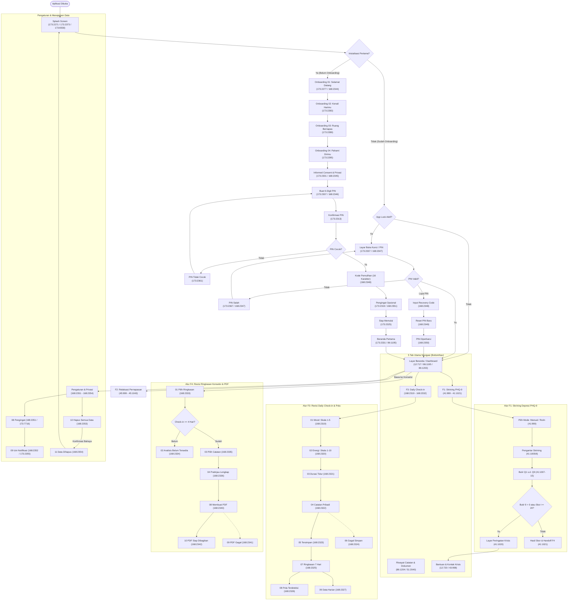

# Screen Inventory & User Navigation Flow — Selaras

| Metadata | Keterangan |
|---|---|
| **Sumber Desain Figma** | `https://www.figma.com/design/RYBsm8MUhzHTJdAGgLz5jT/Serasi---Android-UI---Design-System` |
| **Cakupan Page** | `0:1` (Handoff, V2, REVISI F3, REVISI F4, REVISI Pendukung, Onboarding & PIN Flow), `41:998` (F1 PHQ-9), `45:998` (F2 Pernapasan) |
| **Total Screen Terdata** | **268 Screen Frame Android** (`360×800` & `393×852`) |
| **Status Desain Figma** | **Lengkap & Terverifikasi (Seluruh Fitur Termasuk Onboarding, Consent, PIN, Recovery, Settings, dan Revisi F3/F4 Telah Tersedia di Figma)** |
| **Status Dokumen** | **Verified (Diekstrak Langsung via Figma MCP)** |
| **Versi Dokumen** | 1.1.0 |
| **Terakhir Diperbarui** | 2026-11-20 |

---

## 1. Diagram Alur Navigasi Utama (*User Journey Flowchart*)

Diagram berikut menggambarkan perpindahan seluruh layar dalam aplikasi Selaras, mulai dari peluncuran awal hingga fitur pendukung:

---

## 2. Inventarisasi Layar per Kelompok Fitur

### 2.1 Onboarding & Splash Screen (Page `0:1`)
Rangkaian layar pengantar saat pertama kali memasang aplikasi, serta layar pembuka aplikasi.

| Nama Frame Figma | Node ID | Dimensi | Tujuan & Fungsi Layar | Komponen & Aksi Pengguna |
|---|---|---|---|---|
| `Selaras · 01 Splash` | `173:2271` | `393×852` | Layar splash awal saat inisialisasi aplikasi. | Logo Selaras, transisi otomatis setelah inisialisasi Keystore. |
| `Selaras · 18 Splash siap` | `173:2373` | `393×852` | State transisi splash ketika database terenkripsi siap dibuka. | Logo Selaras dan animasi lembut indikator siap. |
| `Selaras · Pengguna kembali / Splash` | `173:6558` | `393×852` | Splash khusus untuk pengguna yang sudah menyelesaikan onboarding. | Logo Selaras, transisi langsung menuju Layar Kunci PIN (`173:2337`). |
| `Selaras · 02 Selamat datang` | `173:2277` | `393×852` | Slide pengantar 1: Sambutan dan orientasi aplikasi. | Ilustrasi selamat datang, teks orientasi, tombol "Lanjut". |
| `REVISI Selaras / Pendukung · 01 Selamat datang` | `168:2344` | `393×852` | Varian alternatif pengantar orientasi aplikasi. | Header selamat datang, ilustrasi menenangkan, tombol "Mulai". |
| `Selaras · 03 Kenali harimu` | `173:2283` | `393×852` | Slide pengantar 2: Penjelasan pencatatan harian (Mood 1–5 & Energi 1–10). | Ilustrasi evaluasi diri, indikator pagination langkah 2 dari 4. |
| `Selaras · 04 Ruang untuk bernapas` | `173:2289` | `393×852` | Slide pengantar 3: Penjelasan fitur relaksasi pernapasan ritmis. | Ilustrasi relaksasi, teks panduan bernapas, pagination langkah 3 dari 4. |
| `Selaras · 05 Pahami dirimu` | `173:2295` | `393×852` | Slide pengantar 4: Penjelasan penapisan PHQ-9 & ringkasan konselor. | Ilustrasi analisis diri, tombol "Mulai Pengaturan". |
| `Selaras · 10 Siap memulai` | `173:2325` | `393×852` | Layar konfirmasi bahwa seluruh onboarding & PIN telah selesai. | Ikon sukses, rangkuman kesiapan aplikasi, tombol "Masuk ke Beranda". |
| `Selaras · 11 Beranda pertama` | `173:2331` | `393×852` | Tampilan beranda pertama kali dengan kartu panduan pengguna baru. | Banner selamat datang baru, tooltip aksi "Catat Check-in Pertamamu". |

---

### 2.2 Informed Consent & Persetujuan Medis (Page `0:1`)
Layar krusial untuk kepatuhan etis dan batasan hukum aplikasi kesehatan mental.

| Nama Frame Figma | Node ID | Dimensi | Tujuan & Fungsi Layar | Komponen & Aksi Pengguna |
|---|---|---|---|---|
| `Selaras · 06 Privasi dan persetujuan` | `173:2301` | `393×852` | Layar penjelasan batasan medis & kebijakan privasi lokal offline. | Teks disclaimer: "Selaras bukan alat diagnosis medis", klausul enkripsi data lokal, checkbox persetujuan, tombol "Saya Setuju". |
| `REVISI Selaras / Pendukung · 02 Persetujuan` | `168:2345` | `393×852` | Revisi terpadu dokumen persetujuan etis pengguna. | Kartu klausul privasi lengkap, tombol persetujuan primer aktif. |
| `Selaras · 13 Persetujuan aktif` | `173:2343` | `393×852` | Status interaktif ketika checkbox persetujuan telah dicentang. | Checkbox terpilih (`#356859`), tombol "Lanjutkan ke Keamanan" aktif. |

---

### 2.3 App Lock, Pembuatan PIN, & Buka Kunci (Page `0:1`)
Sistem autentikasi lokal 6 digit untuk melindungi privasi catatan kesehatan mental.

| Nama Frame Figma | Node ID | Dimensi | Tujuan & Fungsi Layar | Komponen & Aksi Pengguna |
|---|---|---|---|---|
| `Selaras · 07 Buat PIN` | `173:2307` | `393×852` | Layar pembuatan 6-digit PIN awal oleh pengguna baru. | 6 titik indikator kosong (`radius/full`), keypad numerik 0–9. |
| `REVISI Selaras / Pendukung · 03 Buat PIN` | `168:2346` | `393×852` | Revisi layar setup PIN awal dengan penjelasan keamanan. | Teks instruksi: "Buat 6 digit PIN untuk mengunci catatanmu". |
| `Selaras · 07 Buat PIN / 1..6 digit` | `173:6586` s.d. `173:6836` | `393×852` | State dinamis saat digit ke-1 sampai ke-6 dimasukkan pada pembuatan PIN. | Titik indikator berubah menjadi solid `#356859`. Setelah digit ke-6 otomatis beralih ke konfirmasi PIN. |
| `Selaras · 08 Konfirmasi PIN` | `173:2313` | `393×852` | Layar verifikasi ulang 6 digit PIN yang baru dibuat. | 6 titik indikator kosong, instruksi "Masukkan kembali PIN". |
| `Selaras · 08 Konfirmasi PIN / 1..6 digit` | `173:6924` s.d. `173:7174` | `393×852` | State dinamis pengisian digit konfirmasi PIN. | Titik indikator terisi secara visual. |
| `Selaras · 16 PIN tidak cocok` | `173:2361` | `393×852` | State validasi saat PIN konfirmasi berbeda dari PIN awal. | 6 titik berubah merah `#B3261E`, teks peringatan "PIN tidak cocok, silakan ulangi", reset kembali ke langkah buat PIN. |
| `Selaras · 12 Buka kunci` | `173:2337` | `393×852` | Layar App Lock utama saat aplikasi dibuka kembali. | 6 titik PIN, keypad numerik, tombol teks "Lupa PIN?". |
| `REVISI Selaras / Pendukung · 04 Buka kunci dan kesalahan` | `168:2347` | `393×852` | Layar buka kunci dengan penanganan state error terpadu. | Indikator kesalahan visual dan opsi pemulihan kode. |
| `Selaras · 12 Buka kunci / 1..6 digit` | `173:7316` s.d. `173:7561` | `393×852` | State dinamis pengisian PIN pada layar buka kunci. | Titik terisi seiring penekanan keypad numerik. |
| `Selaras · 17 PIN salah` | `173:2367` | `393×852` | State kesalahan saat PIN yang dimasukkan tidak cocok dengan hash PBKDF2. | Efek getar (*shake feedback*), titik indikator merah `#B3261E`, teks "PIN salah. Coba lagi". |

---

### 2.4 Pemulihan PIN & Recovery Code (Page `0:1`)
Fitur keselamatan saat pengguna lupa PIN tanpa server eksternal (ADR-003).

| Nama Frame Figma | Node ID | Dimensi | Tujuan & Fungsi Layar | Komponen & Aksi Pengguna |
|---|---|---|---|---|
| `REVISI Selaras / Pendukung · 05 Pemulihan PIN` | `168:2348` | `393×852` | Penampilan kartu kode pemulihan (saat setup) atau input kode pemulihan (saat lupa PIN). | Kartu kode pemulihan 16 karakter alfanumerik (`XXXX-XXXX-XXXX-XXXX`), tombol "Salin Kode", tombol "Lanjut". |
| `REVISI Selaras / Pendukung · 06 Reset PIN` | `168:2349` | `393×852` | Layar pembuatan PIN baru setelah kode pemulihan berhasil diverifikasi. | Input 6 digit PIN baru dan konfirmasi PIN baru. |
| `REVISI Selaras / Pendukung · 07 PIN diperbarui` | `168:2350` | `393×852` | Konfirmasi sukses penggantian PIN. | Ikon sukses centang hijau, teks "PIN berhasil diperbarui", tombol "Buka Beranda". |

---

### 2.5 Pengaturan (*Settings*), Pengingat, & Hapus Data (Page `0:1`)
Pengelolaan preferensi notifikasi, audit privasi, dan sanitasi data permanen.

| Nama Frame Figma | Node ID | Dimensi | Tujuan & Fungsi Layar | Komponen & Aksi Pengguna |
|---|---|---|---|---|
| `Selaras · 09 Pengingat opsional` | `173:2319` | `393×852` | Penawaran aktivasi pengingat harian pada tahap onboarding. | Switch pengingat, opsi jam bawaan (21.00), tombol "Atur Nanti" & "Aktifkan". |
| `Selaras · 14 Pengingat aktif` | `173:2349` | `393×852` | State visual saat switch pengingat diaktifkan. | Selektor waktu menjadi interaktif. |
| `Selaras · Pengingat / 21.00` | `173:7716` | `393×852` | Tampilan pengaturan jam spesifik pengingat malam. | Pemilih waktu jam:menit interaktif. |
| `Selaras · 15 Izin notifikasi` | `173:2355` | `393×852` | Dialog/layar permintaan izin sistem Android (`POST_NOTIFICATIONS`). | Penjelasan manfaat pengingat lembut harian, tombol "Izinkan" dan "Jangan Sekarang". |
| `REVISI Selaras / Pendukung · 08 Pengingat` | `168:2351` | `393×954` | Layar menu Pengaturan Pengingat lengkap dalam aplikasi. | Switch aktifkan pengingat, baris set jam, opsi getar/senyap, tombol kembali. |
| `REVISI Selaras / Pendukung · 09 Izin notifikasi` | `168:2352` | `393×852` | Edukasi izin notifikasi pada menu pengaturan. | Panduan mengaktifkan izin jika sebelumnya ditolak di pengaturan OS. |
| `REVISI Selaras / Pendukung · 10 Hapus semua data` | `168:2353` | `393×852` | Dialog/Layar konfirmasi bahaya penghapusan data mandiri (Langkah 1). | Kartu peringatan merah `#B3261E`: "Seluruh data check-in, skrining, dan ringkasan akan dihapus permanen", tombol konfirmasi hapus. |
| `REVISI Selaras / Pendukung · 11 Data dihapus` | `168:2354` | `393×852` | Konfirmasi sukses sanitasi basis data (Langkah 2). | Teks "Semua data lokal telah dibersihkan", tombol "Mulai Ulang Aplikasi" menuju Splash awal. |

---

### 2.6 Home & Dashboard (Page `0:1`)
Pusat navigasi utama pengguna setelah berhasil membuka kunci aplikasi.

| Nama Frame Figma | Node ID | Dimensi | Komponen Utama | Aksi Pengguna & Navigasi |
|---|---|---|---|---|
| `V2/Beranda` | `12:717` | `360×800` | Banner salam, kartu status check-in, kartu aksi cepat skrining/napas, BottomNav. | Klik "Mulai Check-in", "Skrining", atau "Latihan Relaksasi". |
| `F3/Beranda` | `86:1195` | `393×852` | Tampilan dashboard saat hari ini belum ada check-in. Kartu kosong "Bagaimana harimu?". | Klik tombol "Catat Hari Ini" $\rightarrow$ `168:2319` (`F3 · 01 Mood`). |
| `F3/Beranda tercatat` | `86:1203` | `393×852` | Tampilan dashboard saat hari ini sudah tercatat. Ringkasan badge mood, jam tidur, level energi. | Klik kartu untuk melihat detail atau klik "Pola Mingguan". |

---

### 2.7 F1 · Skrining Depresi PHQ-9 (Page `41:998` & `43:998`)
Penapisan mandiri berkala menggunakan instrumen baku 9 butir pertanyaan depresi.

| Nama Frame Figma | Node ID | Dimensi | Tujuan & Komponen Layar | Status & Navigasi |
|---|---|---|---|---|
| `F1/Pilih Skrining` | `41:999` | `360×800` | Memilih antara penapisan Rutin atau Manual. | Opsi Rutin & Manual, informasi kuota 1x/minggu. |
| `F1/Manual dipilih` | `41:1000` | `360×800` | Status visual kartu manual aktif terpilih (`#DCECE3`). | Klik "Lanjut" $\rightarrow$ `F1/Pengantar Manual`. |
| `F1/Rutin dipilih` | `41:1001` | `360×800` | Status visual kartu rutin aktif terpilih. | Klik "Lanjut" $\rightarrow$ `F1/Pengantar Rutin`. |
| `F1/Manual terpakai` | `41:1002` | `360×800` | State kuota manual minggu ini telah habis. | Kartu manual disabled (`#E2E8E3`), tombol lanjut dinonaktifkan. |
| `F1/Rutin belum dibuka` | `41:1003` | `360×800` | State kuota rutin belum memasuki jadwal mingguan. | Keterangan tanggal pembukaan sesi rutin berikutnya. |
| `F1/Rutin terpakai` | `41:1004` | `360×800` | State kuota rutin minggu ini telah digunakan. | Keterangan reset kuota setiap hari Senin pukul 00.00. |
| `F1/Pengantar Manual` | `41:1005` | `360×800` | Petunjuk penapisan manual: "Jawab kondisi 2 minggu terakhir". | Tombol "Mulai Penapisan" $\rightarrow$ `F1/Q1`. |
| `F1/Pengantar Rutin` | `41:1006` | `360×800` | Petunjuk evaluasi rutin berkala mingguan. | Tombol "Mulai Penapisan" $\rightarrow$ `F1/Q1`. |
| `F1/Q1` s.d. `F1/Q9` | `41:1007` s.d. `41:1015` | `360×800` | Butir pertanyaan PHQ-9 (1 sampai 9). Teks butir klinis, 4 radio button opsi skor (0–3), indikator langkah. | Memilih opsi jawaban otomatis melanjutkan ke pertanyaan berikutnya. |
| `F1/Memproses tanpa pemicu` | `41:1016` | `360×800` | State kalkulasi skor normal (butir 9 = 0). | Spinner circular loading, teks "Menghitung hasil skrining...". |
| `F1/Memproses dengan pemicu` | `41:1017` | `360×800` | State kalkulasi skor dengan pemicu krisis (butir 9 > 0). | Spinner kalkulasi dengan pengalihan prioritas keselamatan. |
| `F1/Gagal simpan...` | `41:1018`, `41:1019` | `360×800` | State kesalahan saat penyimpanan hasil ke database gagal. | Pesan kegagalan, tombol "Coba Simpan Lagi". |
| `F1/Crisis F1` | `41:1020` | `360×800` | Layar tanggap darurat krisis (terpicu jika butir 9 > 0 atau skor $\ge 20$). | Kontak hotline 119/Sejiwa, tombol "Hubungi Bantuan Segera", pesan empati. |
| `F1/Handoff ke F4 - Pilihan Ringkasan` | `41:1021` | `360×800` | Penampilan skor total (0–27), kategori tingkat keparahan, dan tawaran handoff ke F4. | Tombol "Sertakan ke Ringkasan Konselor" atau "Kembali ke Beranda". |
| `F1/Handoff/Bantuan umum` | `43:998` | `360×800` | Direktori lengkap layanan kesehatan jiwa dan kontak krisis. | Daftar lembaga psikologis, kontak darurat, tips pertolongan pertama. |

---

### 2.8 F2 · Latihan Relaksasi Pernapasan (Page `45:998`)
Panduan latihan pernapasan ritmis berbasis bukti dengan animasi terpandu.

| Nama Frame Figma | Node ID | Dimensi | Komponen & Fitur Layar | Navigasi & Interaksi |
|---|---|---|---|---|
| `F2/Pilih Pola` | `45:999` | `393×852` | Katalog pola pernapasan bawaan (Box Breathing, 4-7-8, dll.) & tab Pola Kustom. | Klik kartu pola untuk memilih; klik tombol "Mulai Sesi". |
| `F2/Pola 0..5 dipilih` | `45:1000` s.d. `45:1005` | `393×852` | State visual saat salah satu pola pernapasan aktif terpilih. | Kartu berpendar dengan border `#356859`, radio button checked. |
| `F2/Daftar Custom` | `45:1006` | `393×852` | Daftar pola pernapasan buatan pengguna yang tersimpan di Room DB. | Tombol tambah FAB "Buat Pola Baru" $\rightarrow$ `F2/Buat Pola`. |
| `F2/Buat Pola` | `45:1008` | `393×852` | Formulir input pola kustom: nama, detik Tarik, detik Jeda, detik Embus. | Validasi durasi integer 1–60 detik, tombol "Simpan Pola". |
| `F2/Validasi gagal` | `45:1010` | `393×852` | State kesalahan jika input durasi tidak valid (misal: 0 detik). | Border TextField merah `#B3261E` dengan pesan koreksi. |
| `F2/Edit Pola` | `45:1011` | `393×852` | Formulir pengubahan nama atau fase durasi pola kustom. | Tombol "Simpan Perubahan" dan tombol sekunder "Hapus Pola". |
| `F2/Konfirmasi Hapus` | `45:1013` | `393×852` | Dialog konfirmasi penghapusan pola pernapasan kustom. | Tombol bahaya "Hapus", memicu penghapusan baris pada tabel `breathing_patterns`. |
| `F2/Sesi 0 Siap` s.d. `Sesi 5 Siap` | `45:1014`, `45:1019` | `393×852` | Layar persiapan sebelum siklus animasi relaksasi dimulai. | Lingkaran visual statis, petunjuk duduk nyaman, tombol "Mulai Bernapas". |
| `F2/Sesi... Tarik / Jeda / Embus` | `45:1015` s.d. `45:1043` | `393×852` | Siklus animasi pernapasan mengembang (Tarik), diam (Jeda), mengempis (Embus). | Berjalan ritmis sesuai durasi detik yang dipilih, teks panduan fase. |
| `WORK · F2 Revisi / Sesi Dijeda` | `122:2499` | `393×852` | Layar overlay saat pengguna menekan tombol pause/jeda di tengah latihan. | Tombol "Lanjutkan Latihan" (resume siklus) dan "Selesaikan Sesi". |

---

### 2.9 F3 · REVISI Daily Check-in & Pola Emosional (Page `0:1`)
Antarmuka hasil revisi terverifikasi untuk evaluasi harian: **Mood (1–5)** dan **Energi (1–10)**.

| Nama Frame Figma | Node ID | Dimensi | Tujuan & Komponen Layar | Detail Spesifikasi & Aksi |
|---|---|---|---|---|
| `REVISI Selaras / F3 · 01 Mood` | `168:2319` | `393×872` | Input evaluasi suasana hati harian. | **Skala 1–5** (Sangat Kurang Baik s.d. Sangat Baik), 5 tombol opsi sentuh. Memilih opsi mengaktifkan tombol "Lanjut". |
| `REVISI Selaras / F3 · 02 Energi` | `168:2320` | `393×852` | Input evaluasi tingkat energi harian. | **Skala 1–10** (10 tombol angka tersusun 2 baris × 5 kolom). Nilai 1 (Habis/Lelah) hingga 10 (Penuh Semangat). Sinkron 1:1 dengan ERD `check_ins.energy`. |
| `REVISI Selaras / F3 · 03 Durasi tidur` | `168:2321` | `393×852` | Input durasi istirahat tidur semalam. | Selektor waktu tidur bulat (0–24 jam), teks panduan kualitas istirahat. |
| `REVISI Selaras / F3 · 04 Catatan pribadi` | `168:2322` | `393×852` | Input jurnal refleksi bebas harian (opsional). | OutlinedTextField multi-baris untuk penulisan refleksi mandiri, tombol "Simpan Catatan". |
| `REVISI Selaras / F3 · 05 Tersimpan` | `168:2323` | `393×852` | Konfirmasi sukses penyimpanan data check-in ke SQLite. | Ikon centang hijau `#356859`, teks "Catatan hari ini berhasil disimpan", tombol "Lihat Ringkasan". |
| `REVISI Selaras / F3 · 06 Gagal simpan` | `168:2324` | `393×852` | State kegagalan database saat penyimpanan entri gagal. | Pesan kesalahan sistem, tombol "Coba Simpan Lagi". |
| `REVISI Selaras / F3 · 07 Ringkasan 7 hari` | `168:2325` | `393×1080` | Analisis tren suasana hati, tidur, dan energi 7 hari terakhir. | Visualisasi grafik batang mood, rata-rata durasi tidur, indikator stabilitas energi. |
| `REVISI Selaras / F3 · 08 Pola terdeteksi` | `168:2326` | `393×868` | Rekomendasi mandiri terpersonalisasi berbasis korelasi data. | Kartu rekomendasi aktivitas (misal: relaksasi pernapasan saat energi rendah dan mood lesu). |
| `REVISI Selaras / F3 · 09 Data harian` | `168:2327` | `393×1052` | Daftar riwayat kronologis seluruh entri check-in harian. | Kartu tanggal harian memuat mood, jam tidur, tingkat energi 1–10, dan cuplikan catatan. |
| `REVISI Selaras / F3 · 10 Satu catatan valid` | `168:2328` | `393×896` | Tampilan visual saat baru terdapat 1 data check-in valid. | Informasi progres menuju pembukaan pola mingguan (butuh minimal 3 hari). |
| `REVISI Selaras / F3 · 11 Belum ada data` | `168:2329` | `393×852` | State kosong ketika belum ada catatan check-in sama sekali. | Ilustrasi santai ramah, tombol ajakan "Mulai Catat Hari Ini". |
| `REVISI Selaras / F3 · 12 Memuat analisis` | `168:2330` | `393×852` | State loading kalkulasi agregasi statistik mingguan. | Indikator progres putar circular, teks "Menganalisis pola 7 hari terakhir...". |
| `REVISI Selaras / F3 · 13 Gagal memuat` | `168:2331` | `393×852` | State kesalahan saat pembacaan agregasi catatan gagal. | Pesan error pembacaan data, tombol muat ulang (*retry*). |
| `REVISI Selaras / F3 · 14 Sudah check-in` | `168:2332` | `393×852` | Peringatan saat mencoba check-in dua kali pada hari yang sama. | Informasi "Kamu sudah mencatat kondisi hari ini", tombol "Edit Catatan" atau "Kembali". |

---

### 2.10 F4 · REVISI Ringkasan Konselor & Ekspor PDF (Page `0:1`)
Antarmuka hasil revisi terverifikasi untuk penyusunan laporan data profesional konselor.

| Nama Frame Figma | Node ID | Dimensi | Tujuan & Komponen Layar | Aturan Bisnis & Navigasi |
|---|---|---|---|---|
| `REVISI Selaras / F4 · 01 Pilih ringkasan` | `168:2333` | `393×1096` | Layar utama pembuat ringkasan konselor. | Pilihan periode rentang tanggal, filter data yang akan disertakan, tombol "Lanjut ke Pratinjau". |
| `REVISI Selaras / F4 · 02 Analisis belum tersedia` | `168:2334` | `393×936` | State penolakan pembuatan ringkasan jika syarat data belum cukup. | **Aturan K03/F4**: Menampilkan informasi "Dibutuhkan minimal 4 hari check-in dalam 7 hari terakhir". Tombol pratinjau dinonaktifkan. |
| `REVISI Selaras / F4 · 03 Pilih catatan` | `168:2335` | `393×852` | Layar kurasi catatan jurnal pribadi yang diizinkan untuk disertakan. | Daftar checkbox catatan harian; pengguna bebas memilih mana yang boleh dibaca konselor demi privasi. |
| `REVISI Selaras / F4 · 04 Pratinjau lengkap` | `168:2336` | `393×1400` | Pratinjau komprehensif dokumen konselor (*scrollable*). | Header laporan anonim, rekap skor PHQ-9, grafik mood & energi 1–10, catatan terpilih, tombol primer "Buat PDF". |
| `REVISI Selaras / F4 · 05 Pratinjau skrining` | `168:2337` | `393×852` | Pratinjau khusus jika pengguna hanya menyertakan data skrining depresi. | Rekap hasil penapisan berkala tanpa jurnal harian. |
| `REVISI Selaras / F4 · 06 Sumber berubah` | `168:2338` | `393×852` | Peringatan integritas data jika entri sumber dihapus/diedit saat pratinjau. | Teks peringatan perubahan data, tombol "Segarkan Pratinjau". |
| `REVISI Selaras / F4 · 07 Menyiapkan pratinjau` | `168:2339` | `393×852` | State proses kompilasi snapshot JSON data lokal. | Indikator loading kompilasi ringkasan. |
| `REVISI Selaras / F4 · 08 Membuat PDF` | `168:2340` | `393×852` | State proses penulisan berkas dokumen PDF ke media penyimpanan lokal. | Progress bar rendering PDF dokumen, teks "Menyusun berkas PDF...". |
| `REVISI Selaras / F4 · 09 PDF gagal` | `168:2341` | `393×852` | State kesalahan sistem saat pembuatan PDF gagal (misal: disk penuh). | Pesan error penulisan storage, tombol "Coba Buat PDF Lagi". |
| `REVISI Selaras / F4 · 10 PDF siap` | `168:2342` | `393×852` | Layar sukses berkas PDF selesai dibuat. | Ikon sukses dokumen, nama berkas PDF, tombol "Buka Berkas PDF" dan "Bagikan Dokumen". |
| `REVISI Selaras / F4 · 11 Skrining kosong` | `168:2343` | `393×852` | State informasi saat ringkasan dibuat tanpa ada data skrining aktif. | Keterangan bahwa hanya data check-in harian yang dicantumkan dalam berkas. |

---

### 2.11 Riwayat (*History*) & Pusat Bantuan Krisis (Page `0:1`, `43:998`, `51:998`)

| Nama Frame Figma | Node ID | Dimensi | Komponen Layar | Aksi & Navigasi |
|---|---|---|---|---|
| `F3/Riwayat` | `86:1204` | `393×852` | Daftar riwayat kronologis check-in harian. | Klik item riwayat untuk membuka detail catatan (`86:1205`). |
| `F3/Riwayat kosong` | `86:1209` | `393×852` | State kosong saat belum pernah ada entri check-in. | Ilustrasi riwayat kosong, tombol "Mulai Catat Hari Ini". |
| `F4 · Riwayat — terisi` | `51:2040` | `360×1504` | Daftar riwayat ringkasan konselor (PDF) yang pernah dibuat. | Daftar berkas tersimpan dengan tanggal ekspor, tombol unduh ulang & buka berkas. |
| `F4 · Riwayat — NO_DATA` | `51:1995` | `360×1070` | State kosong riwayat ringkasan konselor. | Informasi belum pernah membuat ringkasan konselor. |
| `V2/Bantuan` | `12:720` | `360×800` | Tab navigasi Bantuan & Kontak Krisis mandiri. | Tombol panggil darurat 119/Sejiwa, kontak LSM pencegahan bunuh diri. |
| `F1/Handoff/Bantuan umum` | `43:998` | `360×800` | Pusat rujukan darurat lengkap dan panduan pertolongan pertama krisis psikologis. | Tersedia 24 jam dan dapat diakses bebas kapan saja tanpa terkunci kondisi error/loading fitur lain. |

---

## 3. Matriks Status Implementasi Antarmuka

| Modul Fitur | Keberadaan Desain di Figma | Status Sinkronisasi ERD & Domain | Kesiapan Dokumentasi |
|---|:---:|:---:|:---:|
| **Splash & Onboarding** | **Tersedia Lengkap** (`173:2271`–`173:2331`, `168:2344`) | Sinkron (`app_settings.is_onboarding_completed`) | **Verified** |
| **Informed Consent** | **Tersedia Lengkap** (`173:2301`, `173:2343`, `168:2345`) | Sinkron (`app_settings.has_consented`) | **Verified** |
| **App Lock PIN & Recovery**| **Tersedia Lengkap** (`173:2307`, `173:2337`, `168:2346`–`2350`)| Sinkron (`PinManager` PBKDF2 & `RecoveryManager` 16-char)| **Verified** |
| **Settings & Pengingat** | **Tersedia Lengkap** (`168:2351`–`2354`, `173:7716`) | Sinkron (`app_settings.reminder_time`, `clearAllTables`) | **Verified** |
| **Dashboard / Beranda** | **Tersedia Lengkap** (`12:717`, `86:1195`, `86:1203`) | Sinkron dengan state harian Room DB | **Verified** |
| **F1: Skrining PHQ-9** | **Tersedia Lengkap** (`41:999`–`41:1021`, `43:998`) | Sinkron (`screening_sessions`, `screening_answers`) | **Verified** |
| **F2: Relaksasi Pernapasan**| **Tersedia Lengkap** (`45:999`–`45:1043`, `122:2499`) | Sinkron (`breathing_patterns`) | **Verified** |
| **F3: Daily Check-in (Revisi)**| **Tersedia Lengkap** (`168:2319`–`168:2332`)| **Sinkron Penuh (Mood 1–5 & Energi 1–10)** (`check_ins`) | **Verified** |
| **F4: Ringkasan Konselor (Revisi)**| **Tersedia Lengkap** (`168:2333`–`168:2343`)| **Sinkron Penuh (Syarat $\ge 4$ Hari)** (`counselor_summaries`)| **Verified** |
| **Riwayat & Bantuan Krisis** | **Tersedia Lengkap** (`86:1204`, `51:2040`, `12:720`, `43:998`)| Sinkron dengan kueri DAO dan kontak darurat statis | **Verified** |
